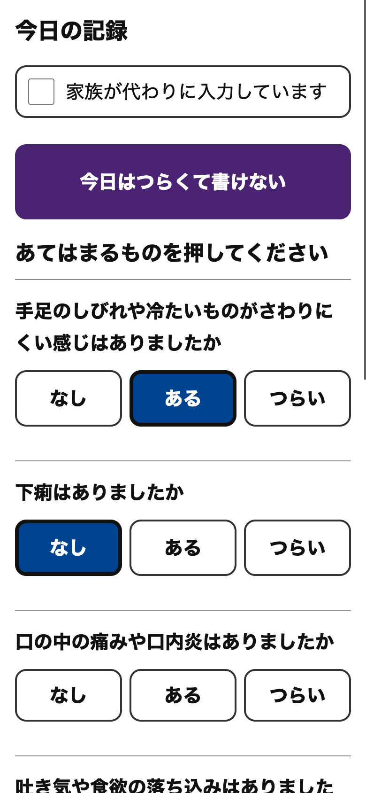
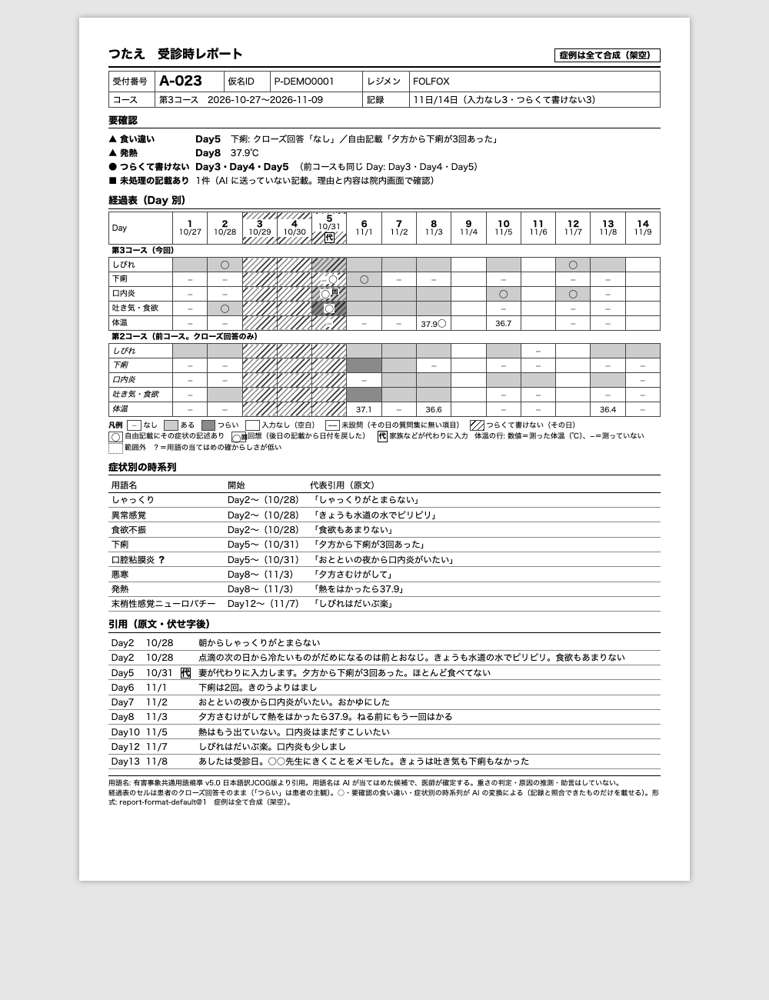
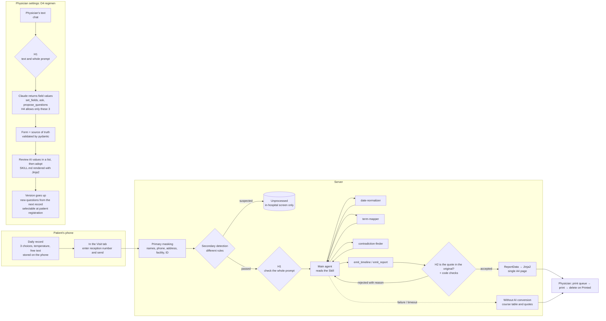

<p align="center">
  
</p>

<h1 align="center">Tsutae (つたえ)</h1>

<p align="center">An app that turns the daily records of patients on chemotherapy into a single A4 page, in a format the physician defines, and delivers it to the consultation room</p>

<p align="center"><strong>All cases are synthetic (no real patient data is used anywhere in the demo or the evaluation)</strong></p>

<p align="center"><a href="README.md">日本語</a> | English</p>

Patients with gastrointestinal cancer on outpatient chemotherapy (FOLFOX/CAPOX) record how they feel on their phone every day. On the day of a visit, they enter their reception number in the app's Visit tab and send their records. Claude then turns the records into a timeline with **calendar dates, cycle days, standard terms, and quotes from the original text**, and the app delivers it to the consultation room as **a single A4 page in a format the physician defines**. The record content stays on the phone; the server holds it only until the page is printed. No AI-written text is ever shown on the patient's phone.

> Submission to Built with Claude (Code): Japan 2026 (solo, newly built during the contest period; first commit 2026-11-03 18:06 JST). All code was written by Claude Code (Claude Opus); OpenAI Codex was used only for read-only reviews.

## Demo video
[Watch the demo video (YouTube, 2 min 55 s, narrated in Japanese)](https://www.youtube.com/watch?v=UVTjTdUxErU)

## Overview
This project helps physicians grasp the symptoms of side effects (adverse events) in patients on cancer chemotherapy in a short time, with fewer things missed.

I have treated cancer as a gastrointestinal surgeon for 25 years, from diagnosis through surgery, chemotherapy and palliative care. Symptoms during chemotherapy change from day to day; a patient may have had hard days but have recovered by the day of the visit, and some things are simply forgotten. Physicians must make decisions from a lot of information in a short consultation, and even after asking, gaps remain.

Tsutae is an app for outpatients with gastrointestinal cancer on chemotherapy and their physicians (end-stage and palliative care are out of scope). Patients record three-choice answers and free text on their phone every day. On the day of a visit, the Claude Agent SDK takes the free text — with names and other identifiers masked — aligns it to dates and symptom terms, and produces a single A4 page with quotes from the original text, which is printed inside the hospital.

Before the consultation, the physician decides what to ask from the "needs checking" items at the top (answers that contradict each other, fever, days the patient felt too unwell to write), compares the same day of the previous cycle in the course table, and can read the free text by symptom in date order. If roughly 2 minutes of history-taking becomes roughly 20 seconds (my own impression), that time can go to decisions and conversation. For a new regimen, the physician only needs to describe it in a chat, and the Claude Agent SDK fills in the settings as instructed; the values it entered are adopted only after the physician checks them. The AI does not grade the severity of side effects or give advice; the physician makes the decisions. Changing an electronic medical record system is a high hurdle, so I deliberately chose paper. Validation with real patients is still ahead, and all cases are synthetic.

## How this differs from existing regimen notebooks
Several regimen-specific notebooks have been published, but they have no common format. Patients have to learn how to fill in each one, and physicians spend time reading pamphlets with different formats and writing styles, so they were hard to put to use. With Tsutae, I focused on making an app that is easy to use for both patients and physicians.

- **One input format**: The input format is the same regardless of the anticancer drugs (the questions themselves change with the regimen)
- **Reminders at a chosen time**: A notification at the time the patient chooses, to reduce missed entries (effect not measured)
- **Record content stays on the phone**: The content of the records is stored on the patient's phone. It is sent to the server only at a visit, and once printed (or after 24 hours if nobody presses the button) the server deletes the record content, the report and the reception number. What remains is the pseudonymous ID, the regimen, actual dosing dates, the question-set version, visit dates and status, markers of the dates on which something was recorded, notification subscriptions, and logs without any text

## Status

| Item | Value |
|---|---|
| Spec | `docs/spec.md` (v1.0, approved 2026-11-03) |
| Test count | 7230 passed / 7230 total (backend 4603/4603, frontend 2627/2627. Updated automatically by `make test`. Tests that call the API are skipped without a key) |
| Accuracy evaluation | Measured 3 times (`docs/eval/2026-11-04.md`, `2026-11-04-2.md`, `2026-11-06.md`; 2 synthetic patients, 4 cycles, 61 events). Latest (current term list): dates 91.8%, terms 91.8%, contradictions recall 100% and precision 100%, "improving" → "none" 0 (of 9), negation → "present" 0 (of 18), quotes 100%. All 5 failures were cases with no term predicted (chills, anorexia ×2, dysgeusia, fatigue). The rise from the previous 75.4% for terms comes from merging three numbness terms into one, which removed 11 mis-assignments between them; it does not mean the conversion itself became more accurate |
| Checked with real Claude | All 7 Agent SDK smoke items OK; demo-patient conversion succeeded (2026-11-04 and 2026-11-06. `docs/eval/demo-visit-20261109-0703.json`, `demo-visit-20261109-1800.json`). The D4 report-format rewrite succeeded on the first try (2026-11-04. `docs/eval/demo-skill-change-20261104-0719.diff`). A D4 regimen was run through twice with FOLFIRI + BV (2026-11-05. `docs/eval/demo-regimen-20261105-0857.json`, `demo-regimen-20261105-2025.json`) |
| Checked in a browser | Registration → recording → reception → report → printed, and more, at phone width and in-hospital PC width, in a configuration that does not call the API. After the move to on-phone storage, also run through in Chrome's mobile view (2026-11-06; configuration that does not call real Claude). There is no record of running through the D4 regimen screens end to end |
| Checked on a real device | On the author's iPhone: notifications (arriving on the lock screen, tap to open, badge, the chosen time, none on days already recorded, none when turned off) and on-phone storage (survives closing and restarting, Visit tab through to the report, refusal after printing) (2026-11-06). **Not yet checked**: a real Android device, a second real phone, sound in silent mode, notifications after a restart, the result of `navigator.storage.persist()`, whether removing the icon deletes the records |

## What it does

```
Patient (phone):    every day, 5 closed questions + free text (stored on the phone) → on visit day, enter the reception number in the Visit tab and send → "Delivered to your doctor"
Server:             mask the received records → turn them into a timeline with the Claude Agent SDK → render the A4 report
Physician (in-hospital PC): print queue → print → "Printed" deletes the report, reception number and received records (deleted after 24 hours even if not pressed)
```



| Screen | Content |
|---|---|
| P0–P3, P5 Patient | Registration (install the app from the registration QR code and enter the ID) / Today's record (none, some, severe; temperature; free text; "Too unwell to write"; entry by a family member — they can also send from their own phone with the same reception number) / Past records (records on the phone) / Visit (enter the reception number and send) / Settings (daily reminder: on/off, time, send a test; delete this phone's registration and records) |
| D1–D3 Physician | Patients and cycles (actual dosing dates, postponements) / Print queue (refreshes every 5 seconds) / Report |
| D4 Change settings | **Regimen**: a form on the left (basics, dosing schedule, side effects, questions for patients, extra instructions) and a chat with Claude on the right. Claude fills in the fields from the physician's text (when unsure, it asks one question at a time with options), and the physician **reviews the values the AI entered in a list before adopting them**. SKILL.md is rendered by code into a fixed shape from the form values, and an adopted regimen can be chosen when registering a patient. Editing an existing regimen creates a draft of version N+1. **Report format**: ask in one sentence and Claude rewrites a copy of SKILL.md; only what the physician approves after viewing the diff is applied |
| D5 Conversion log | Hook firings, sub-agent activity, and durations (no text) |
| D6 Unprocessed | The original text of records that were not sent to Claude because of a suspected masking leak (in-hospital screen only; the paper shows only the count) |

## Technology and requirements

| Item | Content |
|---|---|
| Backend | Python 3.12+, FastAPI, Uvicorn, pydantic, Jinja2, SQLite, pywebpush 2.5.0 |
| AI | Claude Agent SDK (`claude-agent-sdk` 0.2.177). Default models: main agent `claude-opus-5-5`, sub-agents `claude-sonnet-5-5` |
| Frontend | React 18.3.1, TypeScript 5.6.3, Vite 5.4.8, react-router-dom 6.26.2. The patient screens are a web app added to the home screen |
| Tests | pytest, Vitest, Testing Library |
| Demo video production | Remotion 4.0.540 (`video/`; not needed to run the app) |
| Requirements | Python 3.12+, Node.js and npm. Conversion and D4 need an Anthropic API key (secret names are listed in `.env.example`) |
| Development and test environment | Checked on macOS and iPhone. Other OSes and real Android devices have not been checked |

## Why paper
It reaches the physician without integrating with the electronic medical record. Patients never see AI-written text. The report is rendered **deterministically** from `ReportData` with Jinja2 (the AI does not write HTML). It is a single monochrome A4 page, and both the normal version and the "without AI conversion" version have been checked to fit on one page.



*A report for cycle 3 of the demo patient (synthetic), produced by real Claude (2026-11-06, `scripts/run_demo_visit.py`; results in `docs/eval/demo-visit-20261109-1800.html|json`). Recall (moving "mouth sores since the night before last", written on 11/2, back to Day 5), a contradiction (diarrhea on Day 5), and the distinction between negation and improvement ("the fever hasn't come back" on Day 10, "better than yesterday" on Day 6) were output without any correction by the physician. Hiccups and chills did not appear in this run's by-symptom timeline; the original text can be read in the quotes section.*

## How Claude is used


**Conversion pipeline (Claude Agent SDK, `backend/tsutae/pipeline/`)**
- The main agent (the integrator) reads the Skill and calls three sub-agent roles: `date-normalizer` (turns "the day before yesterday" and the like into calendar dates and Days), `term-mapper` (candidate term names from the term list), and `contradiction-finder` (lists contradictions between closed answers and free text **without resolving them**). The three roles have no tools
- Results are received through the custom tools `emit_timeline` / `emit_report` (an in-process MCP server) and checked by pydantic and code. If invalid, the reason is returned and the agent fixes it (event dates must be on or before the record date, Days must match the value recomputed from the actual dosing date, missing or out-of-order symptom rows are rejected)
- Hooks:
  - **H1** Checks the whole prompt for masking leaks right before sending (`UserPromptSubmit`; code checks it a second time as well)
  - **H2** Rejects a quote unless it is a substring of the masked original text
  - **H3** Restricts Skill rewrites to the SKILL.md in a temporary copy
  - **H4** Rejects tools and roles that are not allowed
  - Plus a Hook that records only firings and durations (for D5)
- On failure, timeout or limit overrun, a "without AI conversion" report containing only the course table of closed answers and quotes of the original text is always produced

**Skills (`backend/skills_home/.claude/skills/`)**: `regimen-folfox` and `regimen-capox` (dosing schedule, question set, the fixed 38.0 °C rule), regimens adopted in D4 (`regimen-<identifier>`), and `report-format-default` (report format). The app reads the YAML frontmatter and Claude reads the body. A regimen's SKILL.md is rendered with Jinja2 from the form values (`regimen_forms`) (for FOLFOX/CAPOX it is byte-identical to the current SKILL.md).

**D4 regimen (`backend/tsutae/regimen/`)**: The form on the left is the source of truth. When the physician writes in the chat, Claude returns only field values through three dedicated tools (`set_fields`, `ask`, `propose_questions`; an in-process MCP server), and the server checks them with pydantic and code before putting them into the draft (Claude does not touch SKILL.md or any file; H4 rejects any tool other than these three). One message gets one reply (fields cannot be edited while it is replying). H1 is applied to the physician's text, the whole prompt, and the tool values; if it triggers, nothing is sent. Each value Claude enters carries its source (from the physician's text / a standard value), and fields the physician entered directly are not overwritten unless asked. Before adoption, the physician reviews the AI-entered values in a list (the review is tied to a marker on the confirmation screen; if a value changes afterward, it cannot be adopted). On adoption, SKILL.md is rendered and the version goes up. A regimen that has patients cannot have its schedule changed. Each record keeps the Skill version, so past records are shown with the question set of that time ("−−" in the course table = not asked).

**D4 report format (`backend/tsutae/skillchange/`)**: The physician's one sentence → Claude edits a temporary copy (with H1, H3, H4) → the server validates it and produces a unified diff → when the physician approves, the version goes up and it is written to the main copy. If rejected, the temporary copy is simply discarded.

**How Claude was used in development**: The spec (`docs/spec.md`) and the implementation contract (`docs/architecture.md`) were fixed first, then implementers (Claude Opus) were run in parallel with Claude Code workflows. Each implementer's output was reviewed by two lines — Claude and Codex (read-only) — and the findings were fixed before integration. Decisions and their reasons are in `docs/decisions.md`.

## What the AI does not do
`docs/spec.md` section 12. It does not grade severity (words such as Grade or mild/severe never appear on the paper; checked by tests), triage, advise patients, fill in missing records, or resolve contradictions. The guidance for 38.0 °C or above is the facility's own text, shown by a comparison in the screen's code (the model is not involved).

## Handling of patient information
`docs/spec.md` section 13.
- Names and dates of birth are not collected. Patients are identified by a pseudonymous ID (registered via the registration QR code or the ID)
- Record content stays on the phone. It reaches the server only at a visit and is deleted once printed or after 24 hours (see "Patient records stay on the phone" below)
- Free text is processed in **two stages**. The first stage masks names (before an honorific), phone numbers, email addresses, addresses, facility names and the pseudonymous ID; the second stage detects anything left over with different, stricter rules. A record that is flagged is not sent to Claude at all, and its original text is shown only on the in-hospital screen D6. Records containing the patient's pseudonymous ID or reception number string are not sent either
- The reception number is not sent to Claude. It is deleted together with the report and the conversion result when marked as printed or after 24 hours
- The conversion log keeps only Hook firings, durations and token counts, never text
- For notifications, the server keeps the dates on which records existed (`record_marks`) and the device endpoints (`push_subscriptions`). The notification body is fixed text containing no patient information, and the sending log contains only counts, exception type names and the status codes returned by the push service (no pseudonymous IDs or endpoints)
- The CLI that the Agent SDK launches is given `--no-session-persistence`, so the conversation (prompt and conversion result) is not left in `~/.claude/projects/`
- The development `CLAUDE.md` (at the repository root) is not read by the conversion agent (`CLAUDE_CODE_DISABLE_CLAUDE_MDS=1`). The conversion rules are only the system prompt and the Skills
- Expired reports are deleted by a cleanup every 10 minutes and when the list is displayed (the DB uses `secure_delete`, and the WAL is checkpointed after deletion)
- Detection misses cannot be brought to zero (see "Known limitations" below). **This project runs only on synthetic data and does not send real patient data.** Real-world use requires the patient's consent and minimizing what is sent (special-care-required personal information under Japanese law)

## Running it (development)
Before starting, copy `.env.example` to `.env` and fill in the values (`.env` is never committed). Conversion and D4 need an API key. If `DOCTOR_PASSWORD` is left empty you cannot log in to the physician screens, and if `TSUTAE_SECRET` is left empty the cookie signing key is empty, so set both. In step 3, `TSUTAE_DB` is the DB to use and `TSUTAE_TODAY` is a fixed "today" for the demo.

```bash
# 1. Setup (Python 3.12)
python3.12 -m venv .venv && .venv/bin/pip install -e ".[dev]"
(cd frontend && npm install)

# 2. Load synthetic data (existing patients are skipped; the DB is not wiped)
#    --device-records: load only patients, cycles and date markers (the records go on the phone)
.venv/bin/python scripts/seed_demo.py --db data/device.db --device-records

# 3. Start (in separate terminals). With TSUTAE_DEMO_TOOLS=1, the demo patient's settings show "Load sample records"
TSUTAE_DB=data/device.db TSUTAE_DEMO_TOOLS=1 TSUTAE_TODAY=2026-11-09 make dev-api   # http://127.0.0.1:8000
make dev-web                                                                        # http://127.0.0.1:5173
```
- Records are entered on the phone (browser) side. Use "Load sample records" in Settings to put the demo patient's synthetic data on the device, then enter the reception number in the Visit tab and send. If you send the samples against a DB made with `make seed` (without `--device-records`, which also puts records in the server DB), reception counts them twice, so create a new DB

<details>
<summary>Trying it on a phone and with notifications (detailed steps)</summary>

- Try it on a phone (same Wi-Fi): make the registration QR URL point to the Mac's IP. When it points anywhere other than localhost, startup stops if the default key and password are still in place
  ```bash
  TSUTAE_DB=data/device.db TSUTAE_DEMO_TOOLS=1 TSUTAE_TODAY=2026-11-09 TSUTAE_PUBLIC_BASE_URL=http://<Mac IP>:5173 \
    TSUTAE_SECRET=$(python3 -c "import secrets;print(secrets.token_urlsafe(32))") \
    DOCTOR_PASSWORD=<demo password> make dev-api
  (cd frontend && npx vite --host 0.0.0.0)
  ```
  This opens the dev server to the Wi-Fi, so anyone on that Wi-Fi can read even `.env` (the same hole as in the Serve note below). Use it only on a trusted Wi-Fi such as at home, and stop it when you are done
- Try the daily notification (HTTPS is required; notifications do not work over `http://` on the same Wi-Fi. Use a fixed Tailscale Serve URL. Do not expose it publicly):
  1. Install the Tailscale app on both the Mac and the iPhone and log in with the same account. Keep the iPhone's VPN on. Allow HTTPS when asked the first time. If "Block incoming connections" (Shields Up) is on in Tailscale on the Mac, the iPhone cannot open the page (Safari says the server has stopped responding), so turn it off only while checking with `tailscale set --shields-up=false` and turn it back on afterward. The Mac itself could not reach the `ts.net` URL over TLS, so open the physician screens on the Mac at `http://localhost:5173`. If the URL changes, the home-screen app and the notification subscription become different ones, so do not use a Quick Tunnel
  2. Generate the notification keys (VAPID) and write the three printed lines into `.env` (do not commit it). Change `TSUTAE_VAPID_SUBJECT` to your own contact (`mailto:` or `https://`)
     ```bash
     .venv/bin/python scripts/gen_vapid.py   # prints to standard output only; writes no file
     ```
     If the keys are missing, broken, or the public and private keys are not a pair, startup does not stop; only notifications become "unavailable". If you regenerate the keys, already-registered devices receive nothing until notifications are turned on again
  3. Also write fixed values for `TSUTAE_SECRET` and `DOCTOR_PASSWORD` into `.env`. Startup stops with the defaults. If `TSUTAE_SECRET` changes on every start, patients' cookies become invalid and they have to enter their ID again
  4. Start (do not write the actual URL in public material)
     ```bash
     TSUTAE_DB=data/device.db TSUTAE_DEMO_TOOLS=1 TSUTAE_TODAY=2026-11-09 TSUTAE_PUBLIC_BASE_URL=https://<Mac name>.<tailnet>.ts.net make dev-api
     (cd frontend && npm run build && npx vite preview --host 127.0.0.1 --port 5173 --strictPort)
     tailscale serve --bg 5173   # open after preview is running; reaches only your own Tailscale devices
     caffeinate -dims   # keep the Mac awake at notification time
     ```
  5. Turn on the iPhone's VPN and open the URL in Safari → Add to Home Screen → enter the ID in the app → in Settings, "Turn on reminders" → "Send a test notification" (arrives after 10 seconds). The items to check are in `docs/plan-device-records.md` §9

  - **Add `TSUTAE_TODAY=2026-11-09`**. The seed also puts markers on the demo patient's future dates (the same with `--device-records`), so `P-DEMO0001` has markers for 11/7 and 11/8. If you run with the real date, the daily notification does not arrive on those two days even though nothing was recorded, and nothing appears in the log (this is per spec; the test send ignores markers and does arrive). 11/9 has no marker, and we confirmed with a temporary DB that a 20:00 subscription receives it (sent on 11/6 and 11/9–11/15, not on 11/7 and 11/8). After a notification is sent or a record is made, nothing more arrives that day. Restarting the server resets the date to 11/9, so to keep checking, move to the next day, e.g. `TSUTAE_TODAY=2026-11-10` (with the seed as is, there are no markers until 11/15)
  - **Expose only `vite preview` via Serve. Never expose the dev server** (`npx vite`, `make dev-web`). The current Vite 5.4.8 dev server lets `/@fs/<absolute path>?import&raw??` bypass the `server.fs` check, so Tailscale devices could read `.env` (API key, signing key, VAPID private key) and the DB. A `--bg` Serve keeps running, so do not start the dev server while it is exposed. preview returns only what is inside `dist/` (checked in `frontend/src/previewServing.test.ts`, and also confirmed working on the author's iPhone over Serve). After changing the screens, start again from `npm run build`
  - Only 5173 needs to be open (preview forwards `/api` to 8000, inheriting `server.proxy`). `--host 127.0.0.1` is because on this Mac `localhost` resolves to `::1` first, which may not reach Serve's forwarding target (presumably 127.0.0.1). It is not opened to the same Wi-Fi
  - Vite 5.4.8 has no `allowedHosts` check. When upgrading, add `.ts.net` to `preview.allowedHosts` (`docs/decisions.md`)
  - When `TSUTAE_PUBLIC_BASE_URL` is https, cookies get `Secure`. Open the physician screens at the same URL or at localhost (if you cannot log in, use the same URL)
  - A home-screen app added from `http://<Mac IP>:5173` is a different origin, so add it again
  - Do not use Funnel. It publishes to the whole world, and anyone could send a reception for `P-DEMO0001`, which appears in the public repository, and incur Claude costs. Even with Serve, stop it except around filming (`tailscale serve reset`; check it when setting up)
  - If the iPhone's VPN is off, the screen does not open when you open the app or tap a notification. While filming, the VPN indicator shows in the status bar
- Put it on the home screen: on iPhone, "Add to Home Screen" from Safari's share menu; on Android, "Add to Home screen" from Chrome's menu. Opening from the icon gives a full-screen app. On iPhone, the home-screen app and Safari have separate cookies, localStorage and record storage, so in Safari (outside the home screen) every patient screen shows only the add-to-home-screen guide and does not allow recording. On first launch, the app shows "This phone is not registered"; enter the ID there to register (the ID is the "registration ID" next to the registration QR code on the physician screens; for the demo patient it is `P-DEMO0001`). ID entry has been checked on a real iPhone. Android has not been checked on a real device and is expected to need HTTPS for full screen

</details>

- Patient: `http://127.0.0.1:5173/register?pid=P-DEMO0001` (demo patient; a reception number is, for example, `A-023`. In a PC browser, the guide is not shown)
- Physician: `http://127.0.0.1:5173/doctor/login` (the password is the value you put in `.env`)
- Tests / lint: `make test` / `make lint`
- Agent SDK check: `make smoke` / accuracy evaluation: `make eval` (both call the API)
- Sample report: `.venv/bin/python scripts/render_sample_report.py [--fallback]`
- Generate one visit for the demo patient with real Claude: `.venv/bin/python scripts/run_demo_visit.py` (uses a temporary DB; results in `docs/eval/demo-visit-*.html|json`; `--dry-run` does not call the API)
- Create one D4 regimen with real Claude: `.venv/bin/python scripts/run_demo_regimen.py [--json] [--adopt]` (a few chat turns that build FOLFIRI + BV. Runs on a temporary DB and a copy of the Skills without changing the main ones. Prints a table of seconds, cost and rejection count per turn; `--json` writes `docs/eval/demo-regimen-*.json|md`)
- Try one D4 report-format rewrite with real Claude: `.venv/bin/python scripts/run_demo_skill_change.py [--request <request text>] [--approve]` (runs on a temporary copy; the main SKILL.md is not changed. The diff goes to `docs/eval/demo-skill-change-*.diff`)

## Daily reminder
Once a day, the home-screen app prompts the patient to record, using fixed text (implementation notes in `docs/architecture.md` section 11).

- **Text**: title "つたえ" (Tsutae), body "今日の記録をお願いします。つらい日はボタンひとつで記録になります。" ("Please record today. On hard days, one button is enough to make a record."). Only the fixed text in `patient_strings.json`; no symptoms, regimen names, drug names or AI-written text
- **When**: the patient chooses a time per device in 30-minute steps (default 20:00). At most once a day, with no repeated nagging (turning it off and on again does not produce a second one that day). If there is a record for that day, written on any device, nothing is sent. "Too unwell to write" counts as written
- **Keeping subscriptions in sync**: when the app is opened, returned to, or an ID is registered, the subscription of a device that has reminders on is sent to the server again (so it keeps arriving after the DB is rebuilt or after registering with a different ID, without opening Settings). A subscription that the push service has removed shows as off the next time the app is opened, and can be turned on again
- **Until when**: until Day 1 of the last cycle + the length of one cycle + 14 days. Registering the next cycle resumes it
- **No notifications to the medical institution**: notifications only prompt the patient; there is no feature that alerts the medical institution between visits (that is for each facility to decide)
- **What was checked**: automated tests (only the push destination is swapped; real pywebpush down to encryption and signing). On the author's real iPhone (2026-11-06, over Tailscale Serve): arriving on the lock screen, tap to open, badge, the chosen time, none on days already recorded, none when turned off. Sound in silent mode is not checked. **Android not checked on a real device** (no device available)

## Patient records stay on the phone
The record content is kept on the phone (IndexedDB in the home-screen app) and sent to the server only at a visit (spec in `docs/plan-device-records.md`, implementation notes in `docs/architecture.md` sections 12 and 13).

- **Every day**: when the patient presses record, the server marks today's date and returns the date and time (no text is sent), and the phone saves the record with those values. The device clock is not used, so Days do not drift. Being online is required; records cannot be made without a connection
- **Visit**: when the patient enters the reception number in the Visit tab and sends, the records from Day 1 of the previous cycle to today reach the server. The server checks them (up to 500 records and 5 MB, record dates within range and not in the future, answers checked against the question set of that record's version; if even one is invalid, the whole submission is refused), stores them temporarily, and passes them to the same conversion as before. The screen shows only "Delivered to your doctor"
- **Registration**: the registration QR code remains as the way to install the app. The in-hospital QR code at visits was dropped (the iPhone camera opens it in Safari, which cannot reach the home-screen app's records). In iPhone Safari only the add-to-home-screen guide is shown; registration is done by entering the ID inside the app
- **Deletion**: once printed or after 24 hours, the received records are deleted together with the report, the conversion result and the reception number (when the patient has no other open visit). Records on the phone stay until the patient deletes them (they can be reviewed in P2, and the next visit needs the previous cycle). "Delete this phone's registration and records" in Settings deletes this device's registration and records
- **Lost records**: they are not restored. Days that have a date marker but whose records did not arrive are shown as "days whose records did not arrive" in the "needs checking" section of the paper and in the header breakdown. The course table stays blank for those days, and they are not counted as "no entry"
- **What stays on the server**: pseudonymous ID, regimen, actual dosing dates, question-set version, date markers, notification subscriptions, logs without text
- **38.0 °C guidance**: shown by a comparison in the screen's code. Temperature is not sent to the server for that check (it only arrives with the records at a visit)
- **What did not change**: no AI-written text on the patient's phone. Conversion reads `entries` in the DB (the received records are put there temporarily). Masking and Hooks before sending to Claude, the D6 flow, and how the report is rendered
- **What was checked**: automated tests (storage runs on `fake-indexeddb`). On the author's real iPhone (2026-11-06): records survive closing and restarting, Visit tab through to the report, refusal after printing. The result of `navigator.storage.persist()` and whether removing the icon deletes the records are not checked. **Android not checked on a real device**


## Known limitations
- Masking misses (listed in `backend/tsutae/masking/__init__.py`): addresses without a house number, names without an honorific ("孫の蓮が来た", "my grandson Ren came"), English honorifics. A one-character given name + さん/くん/ちゃん ("翔さん", "孫の蓮くん", "葵ちゃん") is caught by the second stage and not sent (one-character kinship terms are let through by an allow list)
- The patient's registration QR code carries the pseudonymous ID. In real use it should be a single-use, high-entropy registration token
- The physician screens use a single demo password (repeated failures return 429; an issued cookie stays valid for 12 hours even after logout). Starting anywhere other than localhost with the default key and password stops at startup
- The attempt limit is counted only within the process. Behind a proxy, it assumes a trusted proxy overwrites X-Forwarded-For (`make dev-api` uses `--no-proxy-headers`). When opened via Serve, traffic goes through Vite, so all devices count as a single client
- The hard-coded-text check for patient screens looks at "Japanese string literals" and "English text in JSX". English text that goes through a variable is outside the check
- D5 polls every few seconds (not SSE)
- If a visit whose generation failed is received again with the same reception number and no new records, it is not regenerated (view the conversion log from "Failed" on the physician screens; the "without AI conversion" report is produced by the recovery at startup or by the failure handling)
- Conversion runs in the same process as the API server. `--workers 1` is assumed
- Notifications do not arrive while the server (Mac) is stopped or asleep. Anything more than 10 minutes past its time is not resent. The sound is the device's notification sound and is expected not to play in silent mode. On Android the badge may be just a dot (neither checked on a real device)
- A visit whose generation stopped midway is recovered as a "without AI conversion" report by the cleanup at startup and every 10 minutes (it can then be regenerated with "Convert again with AI")
  - Only generations with no activity for 120 seconds past `pipeline_timeout_s` are recovered (a normal generation is cut off at `pipeline_timeout_s`). "Convert again with AI" also returns 409 for a visit that is generating, so recovery and regeneration never overlap
- Recording requires being online and cannot be done without a connection (the Service Worker is for notifications only and does not cache screens)
- If the records on a phone are lost (changing phones, losing it, removing the home-screen icon, etc.), they cannot be restored. The paper only shows "days that did not arrive"; the content does not come back. Because this works per date, if another device has a record for the same day, the day counts as arrived, and a missing half from one device goes unnoticed
- Entry by a family member can be done on the patient's phone or on the family member's own phone. Registering with the same ID and sending the same reception number in the Visit tab joins the same visit, and new records trigger an automatic re-conversion (if generating, once after it finishes; automatic re-conversion is up to 3 times per visit, after which the print-queue row shows "additional records" and "Convert again with AI" can be pressed). A report already opened in another tab stays stale, so a tag on the print-queue row signals it. Entering the wrong number creates a separate visit and two rows, but both are converted with all the records (the earlier row is also re-converted automatically). To limit cost, one patient can open at most 5 visits per day. Not checked on a real device
- If the patient already has a printed visit today, reception is refused from any device and any number ("It has already been delivered to your doctor. Please speak to the reception desk."; the records stay on the device). A second visit on the same day is handled at the reception desk
- Patient-data retention still has items to decide before real use (spec 13.3): no retention period for date markers; no procedure to delete even the markers when consent is withdrawn; between reception and printing, the original free text is kept on the server in its pre-masking form; storage is unencrypted SQLite; physicians operate with one shared password, so who did what cannot be recorded; viewing on a lost device relies on the phone's lock. The demo runs on synthetic data only
- Out of scope: voice input, offline operation (the Service Worker is for notifications only), restoring lost records (encrypted backups), moving records from an existing DB to devices, electronic medical record integration, notifying the medical institution between visits (for each facility to decide), CAPOX synthetic data and evaluation, formats for two or more physicians

## Documents
The documents below are written in Japanese.
- Spec: `docs/spec.md`
- Implementation contract: `docs/architecture.md`
- Decisions and reasons: `docs/decisions.md`
- Development history: [`docs/development-history.md`](docs/development-history.md)
- Schedule: `docs/plan.md` / tasks: `docs/tasks.md`
- Spec for daily reminders and on-phone storage: `docs/plan-device-records.md`
- Concept (source of truth): `docs/reference/concept.md`

## Sources and terms of use
- Adverse event term names come from this app's term list (`backend/tsutae/data/ctcae_terms.json`)

## License
[MIT](LICENSE)
