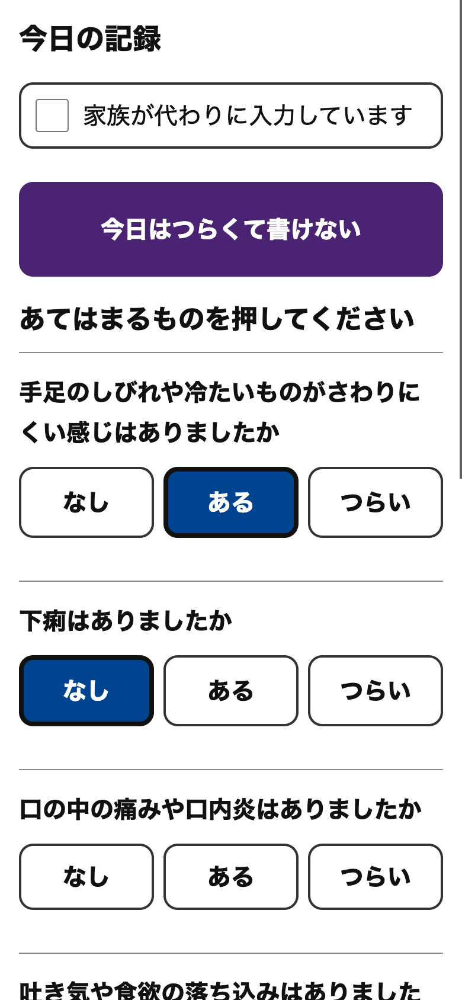
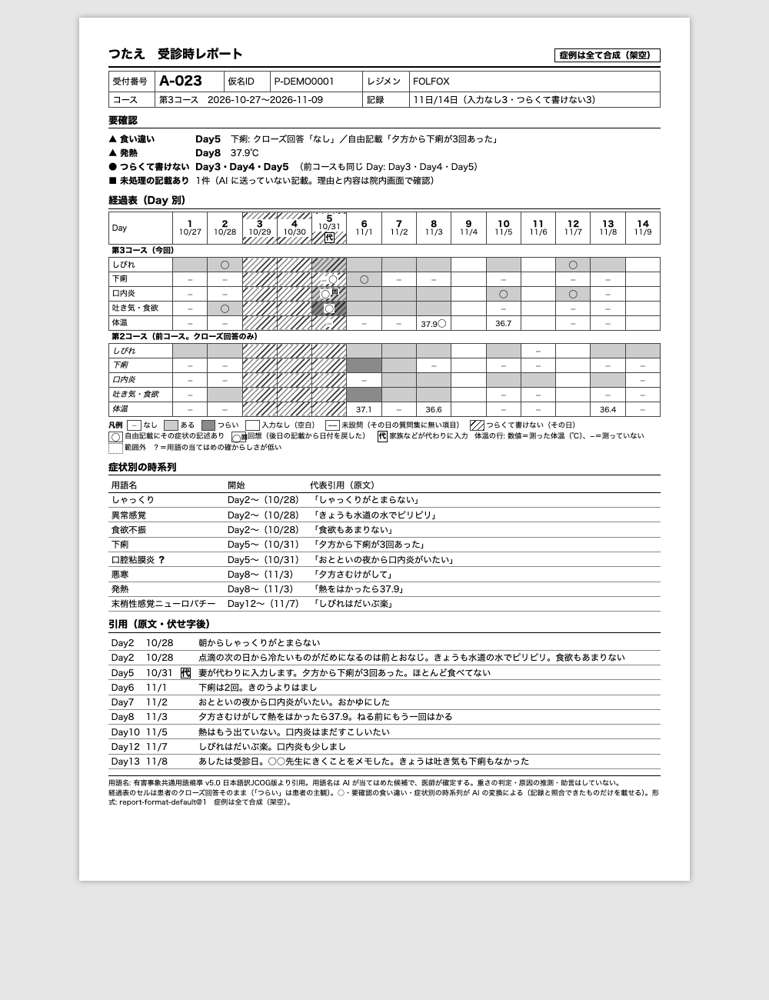
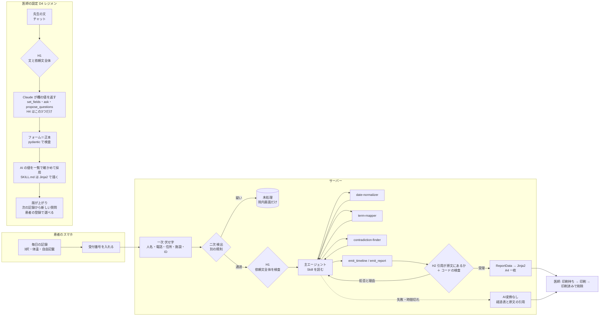

# つたえ — 症例は全て合成です（デモ・評価に実患者のデータは一切使っていません）

外来化学療法（FOLFOX/CAPOX）中の消化器がん患者が毎日スマホで記録し、受診時に院内QRを読むと、Claude が記録を「暦日・コース日数・標準用語・原文引用」つきの時系列に直し、**医師が決めた形式の A4 一枚**として診察室に届けるアプリです。患者のスマホに AI の文は出ません。

> Built with Claude (Code): Japan 2026 提出作品（ソロ、期間中の新規制作）。コードは全て Claude Code（Claude Opus）が書き、OpenAI Codex は読み取り専用のレビューにだけ使いました。

## 状態

| 項目 | 値 |
|---|---|
| 仕様 | `docs/spec.md`（v1.0、2026-11-03 承認） |
| テスト件数 | 6191件 通過 / 全6191件（backend 4063/4063、frontend 2128/2128。`make test` が自動更新。API を呼ぶテストはキーが無いと skip） |
| 精度評価 | 2回実測（`docs/eval/2026-11-04.md`・`2026-11-04-2.md`、合成2人・4コース・出来事61件）。2回目: 日付 93.4%、用語 75.4%、食い違い 再現率 100%・適合率 100%、改善中→なし 0件（9件中）、否定→あり 0件（18件中）、引用 100%。失敗 15 件のうち 11 件は「異常感覚」と「錯感覚」の当て分け（正解ラベルの臨床レビュー待ち） |
| 動作確認 | ブラウザ（スマホ幅・院内 PC 幅）で 登録 → 記録 → 38.0℃ の案内 → 履歴 → 受付 → 印刷待ち → レポート → 変換ログ → 未処理 → 設定の書き換えと承認・却下 → 印刷済み → コース登録 を通しで確認（API を呼ばない構成で5回）。**本物の Claude**: Agent SDK のスモーク7項目が全て OK、デモ患者の変換が1回で成功（ready・AI変換なしでない・H2 の拒否0回、2026-11-04）。一文で頼む D4（当時は regimen-folfox に質問を足す書き換え。今はレポートの形式だけ）の本物の書き換えも1回で成功（pending・差分 2 行追加・H3 の拒否0回・約 0.10 ドル、2026-11-04。`docs/eval/demo-skill-change-20261104-0719.diff`）。新しい D4 レジメン（チャットで作る）も FOLFIRI＋BV で2回通した（どちらも1往復・未入力0・ツール3回・拒否0・H4 の拒否0、一時の写しの上で採用まで。32.8 秒・約 0.12 ドルと 36.0 秒・約 0.13 ドル、2026-11-05。`docs/eval/demo-regimen-20261105-0857.json`・`demo-regimen-20261105-2025.json`）。レジメンの画面のブラウザでの通しは未実施。毎日の通知は自動テストまでで、実機では未確認 |

## 何をするか

```
患者（スマホ）: 毎日 クローズ質問5問＋自由記載 → 受診日に待合で院内QR → 受付番号を入れる →「先生に届けました」
サーバー:       今コースの記録を伏せ字にする → Claude Agent SDK で時系列に直す → A4 のレポートを描く
医師（院内PC）: 印刷待ち一覧 → 印刷 →「印刷済み」でレポートと受付番号を削除（押し忘れても 24 時間で削除）
```



| 画面 | 内容 |
|---|---|
| P0〜P3・P5 患者 | 登録（QR）／今日の記録（なし・ある・つらい、体温、自由記載、「つらくて書けない」、家族の代理入力）／これまでの記録／受付／設定（毎日のお知らせ: オン・オフ、時刻、試しに送る） |
| D1〜D3 医師 | 患者とコース（実投与日・延期）／印刷待ち（5秒ごとに更新）／レポート |
| D4 設定を変える | **レジメン**: 左のフォーム（基本・投与スケジュール・副作用・患者への質問・補足の指示）と右の Claude とのチャット。先生の文から Claude が欄の値を入れ（迷えば選択肢つきで1問ずつ聞く）、先生は **AI が入れた値を一覧で確かめてから採用**する。SKILL.md はフォームの値からコードが決まった形で描き、採用したレジメンは患者の登録で選べる。既存のレジメンを直すと版 N+1 の下書きになる。**レポートの形式**: 一文で頼むと Claude が SKILL.md の写しを書き換え、差分を見て承認したものだけが反映される |
| D5 変換ログ | Hook の発火・サブエージェントの動き・所要時間（文面は出さない） |
| D6 未処理 | 伏せ字漏れの疑いで Claude に送らなかった記録の原文（院内画面だけ。紙には件数だけ） |

## なぜ作るか（先生が書く）
- 誰が、どの場面で、どれくらい困っているか
- 聞き取り 約3分 → 約30秒（実感値、未測定）

## 既存品（Juno、国内 ePRO）との違い（先生が書く）
`docs/spec.md` 14節の比較表をここに置く。

## なぜ紙か
電子カルテ連携なしで医師の手元に届く。患者は AI の文を見ない。レポートは `ReportData` から Jinja2 で**決定的に**描く（AI は HTML を書かない）。A4 一枚・モノクロで、通常版と「AI変換なし」版の両方が1ページに収まることを確かめている。



*本物の Claude（主エージェント claude-opus-5-5、3役 claude-sonnet-5-5）が作ったデモ患者（合成）の第3コースのレポート（2026-11-04、`scripts/run_demo_visit.py`。所要83秒・約0.47ドル・H2 の拒否0回。結果は `docs/eval/demo-visit-20261109-0703.html|json`）。回想（11/2 の「おとといの夜から口内炎」を Day5 に戻す）・食い違い（Day5 の下痢）・否定と改善の区別を、医師が直さずに出力した。*

## Claude の使い方


**変換パイプライン（Claude Agent SDK、`backend/tsutae/pipeline/`）**
- 主エージェント（統合役）が Skill を読み、サブエージェント3役を呼ぶ: `date-normalizer`（「おととい」等を暦日・Day に）、`term-mapper`（CTCAE v5.0 JCOG版の用語名の候補）、`contradiction-finder`（クローズ回答と自由記載の食い違いを**解決せずに**並べる）。3役はツールを持たない
- 結果はカスタムツール `emit_timeline` / `emit_report`（同じプロセス内の MCP サーバー）で受け取り、pydantic とコードで検査する。不正なら理由を返して直させる（出来事の日付は記録日以前、Day は実投与日から数え直した値と一致、症状の行の欠け・順序違いは拒否）
- Hook:
  - **H1** 送る直前に依頼文全体を伏せ字漏れ検査（`UserPromptSubmit`。コードでも二重に検査）
  - **H2** 引用が伏せ字後の原文に部分一致しなければ拒否
  - **H3** Skill の書き換え先を一時コピーの SKILL.md に限る
  - **H4** 許可外のツール・役を拒否
  - 他に、発火と所要時間だけを記録する Hook（D5 用）
- 失敗・タイムアウト・上限超過では、クローズ回答の経過表と原文引用だけの「AI変換なし」レポートを必ず作る

**Skill（`backend/skills_home/.claude/skills/`）**: `regimen-folfox`・`regimen-capox`（投与日程・質問集・38.0℃の固定規則）と D4 で採用したレジメン（`regimen-<識別名>`）、`report-format-default`（レポート形式）。YAML frontmatter をアプリが読み、本文を Claude が読む。レジメンの SKILL.md はフォームの値（`regimen_forms`）から Jinja2 で描く（FOLFOX/CAPOX は今の SKILL.md とバイト一致）。

**D4 レジメン（`backend/tsutae/regimen/`）**: 左のフォームが正本。先生がチャットに書くと、Claude は専用の3つのツール（`set_fields`・`ask`・`propose_questions`。同じプロセスの MCP サーバー）で欄の値だけを返し、サーバーが pydantic とコードで検査して下書きに入れる（Claude は SKILL.md もファイルも触らない。H4 で3つ以外のツールを拒否）。1回送ると1回答える（応答中は欄を直せない）。先生の文・依頼文の全体・ツールの値に H1 を掛け、掛かれば送らない。Claude が入れた値には出どころ（先生の文から／標準の値）を持たせ、先生が直接入れた欄は頼まない限り書き換えさせない。採用の前に AI が入れた値を一覧で確かめ（確かめは確認の画面の印に結びつき、その後に値が変われば採用できない）、採用すると SKILL.md を描いて版を上げる。患者のいるレジメンは日程を変えられない。記録ごとに Skill の版を持つので、過去の記録は当時の質問集で表示される（経過表の「−−」＝未設問）。

**D4 レポートの形式（`backend/tsutae/skillchange/`）**: 医師の一文 → 一時コピーを Claude が編集（H1・H3・H4 付き）→ サーバーが検証して unified diff → 医師が承認すると version を上げて本体へ書き込む。却下なら一時コピーを捨てるだけ。

**開発での使い方**: 仕様（`docs/spec.md`）と実装の契約（`docs/architecture.md`）を先に固め、Claude Code のワークフローで実装担当（Claude Opus）を並列に動かした。各担当の成果は Claude と Codex（読み取り専用）の2系統でレビューし、指摘を直してから統合した。決めたことと理由は `docs/decisions.md`。

## AI がしないこと
`docs/spec.md` 12節。重さの判定（Grade・軽症/重症などの語を紙に出さない。テストで検査）・トリアージ・患者への助言・欠けた記録の補完・食い違いの解決をしない。38.0℃以上の案内は、施設の案内文をコードの比較で出すだけ（モデルは関与しない）。

## 患者情報の扱い
`docs/spec.md` 13節。
- 氏名・生年月日を集めない。患者は仮名ID（QR）で識別する
- 自由記載は**二段**で処理する。一次で人名（敬称の前）・電話・メール・住所・施設名・仮名ID を伏せ字にし、二次では一次と別の、より厳しい規則で取り残しを検出する。検出された記録は丸ごと Claude に送らず、院内画面 D6 だけに原文を出す。その患者の仮名ID・受付番号の文字列を含む記録も送らない
- 受付番号は Claude に送らない。印刷済み操作か 24 時間で、レポート・変換結果と一緒に消す
- 変換ログには Hook の発火・所要時間・トークン数だけを残し、文面を残さない
- 通知のために、サーバーに記録があった日付（`record_marks`）と端末の送り先（`push_subscriptions`）を置く。通知の本文は固定文で患者の情報を含まず、送信のログは件数と例外の型名だけ
- Agent SDK が起動する CLI には `--no-session-persistence` を付け、会話の記録（依頼文・変換結果）を `~/.claude/projects/` に残さない
- 開発用の `CLAUDE.md`（リポジトリ直下）は変換エージェントに読ませない（`CLAUDE_CODE_DISABLE_CLAUDE_MDS=1`）。変換の決まりは system prompt と Skill だけ
- 期限切れのレポートは 10 分ごとの掃除と一覧の表示時に消す（DB は `secure_delete`。消した後に WAL も書き戻す）
- 検出漏れはゼロにできない（下の「既知の限界」）。**本プロジェクトは合成データだけで運用し、実患者のデータを送らない**。実運用では本人同意と送る情報の最小化が前提（要配慮個人情報）

## 動かし方（開発）
```bash
# 1. 準備（Python 3.12）
python3.12 -m venv .venv && .venv/bin/pip install -e ".[dev]"
(cd frontend && npm install)

# 2. 合成データを入れる（既にいる患者は飛ばす。DB は消さない）
make seed            # data/tsutae.db（TSUTAE_DB で変更可）

# 3. 起動（別々の端末で）
TSUTAE_TODAY=2026-11-09 make dev-api   # http://127.0.0.1:8000
make dev-web                           # http://127.0.0.1:5173
```
- スマホで試す（同じ Wi-Fi）: 登録用 QR の URL が Mac の IP を指すようにする。localhost 以外を指すときは、既定の鍵・パスワードのままだと起動が止まる
  ```bash
  TSUTAE_TODAY=2026-11-09 TSUTAE_PUBLIC_BASE_URL=http://<Mac の IP>:5173 \
    TSUTAE_SECRET=$(python3 -c "import secrets;print(secrets.token_urlsafe(32))") \
    DOCTOR_PASSWORD=<デモ用のパスワード> make dev-api
  (cd frontend && npx vite --host 0.0.0.0)
  ```
- 毎日の通知を試す（HTTPS が要る。同じ Wi-Fi の `http://` では通知を使えない。Tailscale Funnel の固定 URL を使う）:
  1. Tailscale のアプリを入れてログインし、管理画面で HTTPS と Funnel を許可する。コマンドと画面は導入時に確かめる（この手順はまだ実機で通していない）。URL が変わると、ホーム画面アプリ・通知の登録が別物になるので、Quick Tunnel は使わない
  2. 通知の鍵（VAPID）を作り、出た3行を `.env` に書く（コミットしない）。`TSUTAE_VAPID_SUBJECT` は自分の連絡先（`mailto:` か `https://`）に直す
     ```bash
     .venv/bin/python scripts/gen_vapid.py   # 標準出力に出すだけで、ファイルには書かない
     ```
     鍵が無い・壊れている・公開鍵と秘密鍵が組でないときは、起動を止めず通知だけ「使えません」になる。鍵を作り直すと、登録済みの端末はオンにし直すまで届かない
  3. `TSUTAE_SECRET` と `DOCTOR_PASSWORD` も `.env` に決まった値で書く。既定値のままだと起動が止まる。`TSUTAE_SECRET` を起動のたびに変えると患者の Cookie が無効になり、番号を入れ直すことになる
  4. 起動する（実際の URL は公開の資料に書かない）
     ```bash
     tailscale funnel --bg 5173
     TSUTAE_PUBLIC_BASE_URL=https://<Mac 名>.<tailnet>.ts.net make dev-api
     (cd frontend && npx vite --host 127.0.0.1)
     caffeinate -dims   # 通知の時刻に Mac を眠らせない
     ```
  5. iPhone の Safari で URL を開く → ホーム画面に追加 → アプリで番号を入れる → 設定で「お知らせをオンにする」→「試しに通知を送る」（10 秒後に届く）。確かめる項目は `docs/plan-device-records.md` §9

  - 開けるのは 5173 だけでよい（`/api` は Vite が 8000 へ渡す）。`--host 127.0.0.1` は、この Mac では `localhost` が先に `::1` になり、Funnel の転送先（127.0.0.1 の見込み）に届かないおそれがあるため。同じ Wi-Fi には開かない
  - 開発サーバーの HMR が接続し直しを繰り返すなら `server.hmr.clientPort: 443` にする。撮影は `vite build` と `vite preview --host 127.0.0.1 --port 5173` の方が安全なので、通しで確かめて決める。今の Vite 5.4.8 に `server.allowedHosts` の検査は無い（上げるときは設定が要る）
  - `TSUTAE_PUBLIC_BASE_URL` が https になると Cookie に `Secure` が付く。医師画面は同じ URL か localhost で開く（ログインできなければ同じ URL で）
  - `http://<Mac の IP>:5173` で追加したホーム画面アプリは別のオリジンなので、追加し直す
  - Funnel は外から届くので、撮影の前後以外は止める（`tailscale funnel reset`。導入時に確かめる）
- ホーム画面に置く: iPhone は Safari の共有メニューの「ホーム画面に追加」、Android は Chrome のメニューの「ホーム画面に追加」。アイコンから全画面で開く。iPhone はホーム画面のアプリと Safari で Cookie・localStorage が別で、Safari で済ませた登録は引き継がれない。アプリの初回は「このスマホは登録されていません」の画面で番号を入れて登録する（番号は医師画面の登録用QRの隣の「登録の番号」。デモ患者は `P-DEMO0001`）。番号の入力は iPhone の実機で確認済み。Android は実機で未確認で、全画面になるには HTTPS が要る見込み
- 患者: `http://127.0.0.1:5173/register?pid=P-DEMO0001`（デモ患者。受付番号は例えば `A-023`）
- 医師: `http://127.0.0.1:5173/doctor/login`（パスワードは `DOCTOR_PASSWORD`、既定 `demo-doctor`）
- 環境変数（`.env` に書く）: `ANTHROPIC_API_KEY`（変換と D4 に必須）、`DOCTOR_PASSWORD`、`TSUTAE_SECRET`（Cookie の署名鍵。本番では必ず変える）、`TSUTAE_TODAY`（デモ用に「今日」を固定）、`TSUTAE_DB`、`TSUTAE_MODEL`（既定 `claude-opus-5-5`）、`TSUTAE_SUBAGENT_MODEL`（既定 `claude-sonnet-5-5`）、`TSUTAE_PUBLIC_BASE_URL`（登録用 QR の URL。https なら Cookie に `Secure`）、`TSUTAE_VAPID_PUBLIC_KEY`・`TSUTAE_VAPID_PRIVATE_KEY`・`TSUTAE_VAPID_SUBJECT`（通知の鍵。無ければ通知だけ使えない）
- テスト / lint: `make test` / `make lint`
- Agent SDK の動作確認: `make smoke`／精度評価: `make eval`（どちらも API を呼ぶ）
- 見本のレポート: `.venv/bin/python scripts/render_sample_report.py [--fallback]`
- 本物の Claude でデモ患者の受診を1回生成: `.venv/bin/python scripts/run_demo_visit.py`（一時 DB を使う。結果は `docs/eval/demo-visit-*.html|json`。`--dry-run` なら API を呼ばない）
- 本物の Claude で D4 レジメンを1つ作る: `.venv/bin/python scripts/run_demo_regimen.py [--json] [--adopt]`（FOLFIRI＋BV をチャットで作る数往復。一時の DB と Skill の写しの上で行い、本体は変えない。往復ごとの秒・費用・拒否の回数を表で出し、`--json` で `docs/eval/demo-regimen-*.json|md` に書く）
- 本物の Claude で D4 レポートの形式の書き換えを1回試す: `.venv/bin/python scripts/run_demo_skill_change.py [--request 依頼文] [--approve]`（一時コピーの上で行い、本体の SKILL.md は変えない。差分は `docs/eval/demo-skill-change-*.diff`）

## 毎日の通知
ホーム画面アプリに1日1回、固定文で記録を促します（実装の説明は `docs/architecture.md` 11節）。

- **文**: タイトル「つたえ」、本文「今日の記録をお願いします。つらい日はボタンひとつで記録になります。」。`patient_strings.json` の固定文だけで、症状・レジメン名・薬の名前・AI の文を入れない
- **いつ**: 端末ごとに患者が 30 分刻みで選ぶ（既定 20:00）。1日1回までで、催促の再送はしない。その日の記録があれば、どの端末で書いても送らない。「つらくて書けない」も書いた扱い
- **いつまで**: 最後のコースの Day1 ＋ 1コースの日数 ＋ 14 日まで。次のコースを登録すると再開する
- **医療機関へは通知しない**: 通知は患者への促しだけで、受診の間に医療機関へ知らせる機能は無い（施設が決めること）
- **確かめたこと**: 自動テスト（送信先だけ差し替え、本物の pywebpush で暗号化と署名まで）。**iPhone の実機では未確認**（ロック画面への到着・音・バッジ）。**Android は実機で未確認**（端末が無い）

## 実運用に向けた案: 患者の記録をスマホに置く（未実装）
毎日の通知は上のとおり実装しました。未実装なのは記録の置き場所です。今の実装は、患者の記録をサーバーに残しています。実運用に向けて、記録をスマホの中に置き、サーバーには印刷に必要な間だけ置く形を検討しています。

- **流れ**: 毎日の記録をスマホに保存する → 受診日に院内 QR の URL から、今コースと前コースの記録を送る → 変換して印刷する → 印刷済みか 24 時間で、サーバーの記録もレポートと一緒に消す
- **良くなること**: サーバーに記録がたまらない。保持期限・患者ごとの一括削除・伏せ字前の原文の保管（`docs/spec.md` 13.3）の課題が小さくなり、漏えい時の範囲も狭まる
- **変えないこと**: QR に載せるのは送り先の URL だけで、レポートの URL はスマホに渡さない。患者のスマホに AI の文を出さない
- **解くべきこと**: 機種変更や紛失で記録が消えると、紙の「入力なし」と区別できない。家族が別のスマホで代理入力すると記録が分かれる。端末の時計がずれると Day もずれる。受付から印刷までは、伏せ字前の原文がサーバーに置かれる

## 既知の限界
- 伏せ字の見逃し（`backend/tsutae/masking/__init__.py` に一覧）: 番地の無い住所、敬称の付かない名前（「孫の蓮が来た」）・英語の敬称。1字の名＋さん・くん・ちゃん（「翔さん」「孫の蓮くん」「葵ちゃん」）は二次で拾い、送らない（続柄の1字は許可語で通す）
- 患者の登録用 QR は仮名ID を載せる。実運用では1回限りの高エントロピーの登録トークンにすべき
- 医師画面はデモ用の単一パスワード（失敗が続くと 429。発行済みの Cookie はログアウト後も12時間は有効）。既定の鍵・パスワードのまま localhost 以外で起動しようとすると止まる
- 試行回数の上限はプロセスの中だけで数える。プロキシの後ろに置くときは、信用するプロキシが X-Forwarded-For を上書きする前提（`make dev-api` は `--no-proxy-headers`）。Funnel で開くと Vite を通るので、全ての端末が1つのクライアントとして数えられる
- 患者画面の直書き検査は「日本語の文字列リテラル」と「JSX の英字テキスト」を見る。変数を経由した英字は検査の外
- D5 は数秒ごとのポーリング（SSE ではない）
- 生成に失敗した受診に同じ受付番号で受付し直しても、作り直さない（医師画面の「失敗」から変換ログを見る。AI変換なしのレポートは起動時の回収か失敗時の処理で作られる）
- 変換は API サーバーと同じプロセスで動く。`--workers 1` が前提
- 通知はサーバー（Mac）が止まっている・眠っている間は届かない。時刻から 10 分を過ぎた分は送り直さない。音は端末の通知音で、消音モードでは鳴らない見込み。Android のバッジは点だけのことがある（どちらも実機で未確認）
- 生成が途中で止まった受診は、起動時と10分ごとの掃除で「AI変換なし」のレポートにして回収する（その後「AI でもう一度変換」で作り直せる）
  - 回収するのは `pipeline_timeout_s` を120秒過ぎても動きの無い生成中だけ（本来の生成は `pipeline_timeout_s` で打ち切られる）。生成中の受診には「AI でもう一度変換」も 409 なので、回収と再変換は重ならない
- 患者データの保管は実運用の前に決めることが残る（spec 13.3）: 生の記録の保持期限が無い・患者ごとの一括削除が無い・自由記載の原文が伏せ字の前の形で残る・保管は暗号化の無い SQLite・医師は共有のパスワード1つで操作した人を記録できない。デモは合成データだけで運用する
- 範囲外: 音声入力、オフラインでの動作（Service Worker は通知専用）、電子カルテ連携、受診の間の医療機関への通知（施設が決めること）、CAPOX の合成データ・評価、医師2名以上の形式

## 文書
- 仕様: `docs/spec.md`
- 実装の契約: `docs/architecture.md`
- 決めたことと理由: `docs/decisions.md`
- 日程: `docs/plan.md` ／ タスク: `docs/tasks.md`
- 毎日の通知とスマホ保存の仕様: `docs/plan-device-records.md`
- 企画（正本）: `docs/reference/concept.md`

## 出典・利用条件
- 有害事象の用語名は「有害事象共通用語規準 v5.0 日本語訳JCOG版より引用」。非営利利用の範囲で使用。営利利用は JCOG との別契約が必要
- PRO-CTCAE の文言は使用していない（項目分類のみ参考）

## ライセンス
未定（公開リポジトリ化の際に決める）
