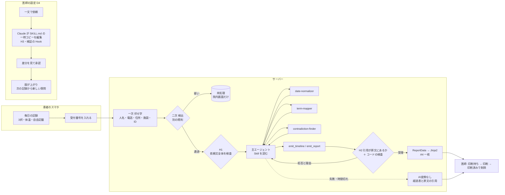

# つたえ — 症例は全て合成です（デモ・評価に実患者のデータは一切使っていません）

外来化学療法（FOLFOX/CAPOX）中の消化器がん患者が毎日スマホで記録し、受診時に院内QRを読むと、Claude が記録を「暦日・コース日数・標準用語・原文引用」つきの時系列に直し、**医師が決めた形式の A4 一枚**として診察室に届けるアプリです。患者のスマホに AI の文は出ません。

> Built with Claude (Code): Japan 2026 提出作品（ソロ、期間中の新規制作）。コードは全て Claude Code（Claude Opus）が書き、OpenAI Codex は読み取り専用のレビューにだけ使いました。

## 状態

| 項目 | 値 |
|---|---|
| 仕様 | `docs/spec.md`（v1.0、2026-11-03 承認） |
| テスト件数 | 3801件 通過 / 全3801件（backend 2755/2755、frontend 1046/1046。`make test` が自動更新。API を呼ぶテストはキーが無いと skip） |
| 精度評価 | 未実施（`make eval` で `docs/eval/` に5指標の実測値と失敗例を残す） |
| 動作確認 | ブラウザ（スマホ幅・院内 PC 幅）で 登録 → 記録 → 38.0℃ の案内 → 履歴 → 受付 → 印刷待ち → レポート → 変換ログ → 未処理 → 設定の書き換えと承認・却下 → 印刷済み → コース登録 を通しで確認（API を呼ばない構成で4回。2026-11-04）。**本物の Claude での変換と D4 は未確認**（`scripts/run_demo_visit.py`・`scripts/run_demo_skill_change.py`・`make smoke` で確かめる） |

## 何をするか

```
患者（スマホ）: 毎日 クローズ質問5問＋自由記載 → 受診日に待合で院内QR → 受付番号を入れる →「先生に届けました」
サーバー:       今コースの記録を伏せ字にする → Claude Agent SDK で時系列に直す → A4 のレポートを描く
医師（院内PC）: 印刷待ち一覧 → 印刷 →「印刷済み」でレポートと受付番号を削除（押し忘れても 24 時間で削除）
```

| 画面 | 内容 |
|---|---|
| P0〜P3 患者 | 登録（QR）／今日の記録（なし・ある・つらい、体温、自由記載、「つらくて書けない」、家族の代理入力）／これまでの記録／受付 |
| D1〜D3 医師 | 患者とコース（実投与日・延期）／印刷待ち（5秒ごとに更新）／レポート |
| D4 設定を変える | 一文で頼むと Claude が Skill（SKILL.md）を書き換え、**差分を見て承認したものだけ**が反映される |
| D5 変換ログ | Hook の発火・サブエージェントの動き・所要時間（文面は出さない） |
| D6 未処理 | 伏せ字漏れの疑いで Claude に送らなかった記録の原文（院内画面だけ。紙には件数だけ） |

## なぜ作るか（先生が書く）
- 誰が、どの場面で、どれくらい困っているか
- 聞き取り 約3分 → 約30秒（実感値、未測定）

## 既存品（Juno、国内 ePRO）との違い（先生が書く）
`docs/spec.md` 14節の比較表をここに置く。

## なぜ紙か
電子カルテ連携なしで医師の手元に届く。患者は AI の文を見ない。レポートは `ReportData` から Jinja2 で**決定的に**描く（AI は HTML を書かない）。A4 一枚・モノクロで、通常版と「AI変換なし」版の両方が1ページに収まることを確かめている。

## Claude の使い方


**変換パイプライン（Claude Agent SDK、`backend/tsutae/pipeline/`）**
- 主エージェント（統合役）が Skill を読み、サブエージェント3役を呼ぶ: `date-normalizer`（「おととい」等を暦日・Day に）、`term-mapper`（CTCAE v5.0 JCOG版の用語名の候補）、`contradiction-finder`（クローズ回答と自由記載の食い違いを**解決せずに**並べる）。3役はツールを持たない
- 結果はカスタムツール `emit_timeline` / `emit_report`（同じプロセス内の MCP サーバー）で受け取り、pydantic とコードで検査する。不正なら理由を返して直させる（出来事の日付は記録日以前、Day は実投与日から数え直した値と一致、症状の行の欠け・順序違いは拒否）
- Hook:
  - **H1** 送る直前に依頼文全体を伏せ字漏れ検査（`UserPromptSubmit`。コードでも二重に検査）
  - **H2** 引用が伏せ字後の原文に部分一致しなければ拒否
  - **H3** Skill の書き換え先を一時コピーの SKILL.md に限る
  - **H4** 許可外のツール・役を拒否
  - 他に、発火と所要時間だけを記録する Hook（D5 用）
- 失敗・タイムアウト・上限超過では、クローズ回答の経過表と原文引用だけの「AI変換なし」レポートを必ず作る

**Skill（`backend/skills_home/.claude/skills/`）**: `regimen-folfox`・`regimen-capox`（投与日程・質問集・38.0℃の固定規則）、`report-format-default`（レポート形式）。YAML frontmatter をアプリが読み、本文を Claude が読む。

**D4 の書き換えループ（`backend/tsutae/skillchange/`）**: 医師の一文 → 一時コピーを Claude が編集（H1・H3・H4 付き）→ サーバーが検証して unified diff → 医師が承認すると version を上げて本体へ書き込み、次の記録から新しい質問集が出る。却下なら一時コピーを捨てるだけ。記録ごとに Skill の版を持つので、過去の記録は当時の質問集で表示される（経過表の「−−」＝未設問）。

**開発での使い方**: 仕様（`docs/spec.md`）と実装の契約（`docs/architecture.md`）を先に固め、Claude Code のワークフローで実装担当（Claude Opus）を並列に動かした。各担当の成果は Claude と Codex（読み取り専用）の2系統でレビューし、指摘を直してから統合した。決めたことと理由は `docs/decisions.md`。

## AI がしないこと
`docs/spec.md` 12節。重さの判定（Grade・軽症/重症などの語を紙に出さない。テストで検査）・トリアージ・患者への助言・欠けた記録の補完・食い違いの解決をしない。38.0℃以上の案内は、施設の案内文をコードの比較で出すだけ（モデルは関与しない）。

## 患者情報の扱い
`docs/spec.md` 13節。
- 氏名・生年月日を集めない。患者は仮名ID（QR）で識別する
- 自由記載は**二段**で処理する。一次で人名（敬称の前）・電話・メール・住所・施設名・仮名ID を伏せ字にし、二次では一次と別の、より厳しい規則で取り残しを検出する。検出された記録は丸ごと Claude に送らず、院内画面 D6 だけに原文を出す。その患者の仮名ID・受付番号の文字列を含む記録も送らない
- 受付番号は Claude に送らない。印刷済み操作か 24 時間で、レポート・変換結果と一緒に消す
- 変換ログには Hook の発火・所要時間・トークン数だけを残し、文面を残さない
- Agent SDK が起動する CLI には `--no-session-persistence` を付け、会話の記録（依頼文・変換結果）を `~/.claude/projects/` に残さない
- 期限切れのレポートは 10 分ごとの掃除と一覧の表示時に消す（DB は `secure_delete`。消した後に WAL も書き戻す）
- 検出漏れはゼロにできない（下の「既知の限界」）。**本プロジェクトは合成データだけで運用し、実患者のデータを送らない**。実運用では本人同意と送る情報の最小化が前提（要配慮個人情報）

## 動かし方（開発）
```bash
# 1. 準備（Python 3.12）
python3.12 -m venv .venv && .venv/bin/pip install -e ".[dev]"
(cd frontend && npm install)

# 2. 合成データを入れる（既にいる患者は飛ばす。DB は消さない）
make seed            # data/tsutae.db（TSUTAE_DB で変更可）

# 3. 起動（別々の端末で）
TSUTAE_TODAY=2026-11-09 make dev-api   # http://127.0.0.1:8000
make dev-web                           # http://127.0.0.1:5173
```
- スマホで試す（同じ Wi-Fi）: 登録用 QR の URL が Mac の IP を指すようにする。localhost 以外を指すときは、既定の鍵・パスワードのままだと起動が止まる
  ```bash
  TSUTAE_TODAY=2026-11-09 TSUTAE_PUBLIC_BASE_URL=http://<Mac の IP>:5173 \
    TSUTAE_SECRET=$(python3 -c "import secrets;print(secrets.token_urlsafe(32))") \
    DOCTOR_PASSWORD=<デモ用のパスワード> make dev-api
  (cd frontend && npx vite --host 0.0.0.0)
  ```
- 患者: `http://127.0.0.1:5173/register?pid=P-DEMO0001`（デモ患者。受付番号は例えば `A-023`）
- 医師: `http://127.0.0.1:5173/doctor/login`（パスワードは `DOCTOR_PASSWORD`、既定 `demo-doctor`）
- 環境変数（`.env` に書く）: `ANTHROPIC_API_KEY`（変換と D4 に必須）、`DOCTOR_PASSWORD`、`TSUTAE_SECRET`（Cookie の署名鍵。本番では必ず変える）、`TSUTAE_TODAY`（デモ用に「今日」を固定）、`TSUTAE_DB`、`TSUTAE_MODEL`（既定 `claude-opus-5-5`）、`TSUTAE_SUBAGENT_MODEL`（既定 `claude-sonnet-5-5`）
- テスト / lint: `make test` / `make lint`
- Agent SDK の動作確認: `make smoke`／精度評価: `make eval`（どちらも API を呼ぶ）
- 見本のレポート: `.venv/bin/python scripts/render_sample_report.py [--fallback]`
- 本物の Claude でデモ患者の受診を1回生成: `.venv/bin/python scripts/run_demo_visit.py`（一時 DB を使う。結果は `docs/eval/demo-visit-*.html|json`。`--dry-run` なら API を呼ばない）
- 本物の Claude で D4 の書き換えを1回試す: `.venv/bin/python scripts/run_demo_skill_change.py [--request 依頼文] [--approve]`（一時コピーの上で行い、本体の SKILL.md は変えない。差分は `docs/eval/demo-skill-change-*.diff`）

## 既知の限界
- 伏せ字の見逃し（`backend/tsutae/masking/__init__.py` に一覧）: 空白・改行をはさんだ「い・く」で終わるひらがなの名前、番地の無い住所、辞書にない1字の名前、敬称の付かない名前・英語の敬称
- 患者の登録用 QR は仮名ID を載せる。実運用では1回限りの高エントロピーの登録トークンにすべき
- 医師画面はデモ用の単一パスワード（失敗が続くと 429。発行済みの Cookie はログアウト後も12時間は有効）。既定の鍵・パスワードのまま localhost 以外で起動しようとすると止まる
- 試行回数の上限はプロセスの中だけで数える。プロキシの後ろに置くときは、信用するプロキシが X-Forwarded-For を上書きする前提（`make dev-api` は `--no-proxy-headers`）
- 患者画面の直書き検査は「日本語の文字列リテラル」と「JSX の英字テキスト」を見る。変数を経由した英字は検査の外
- D5 は数秒ごとのポーリング（SSE ではない）
- 生成に失敗した受診に同じ受付番号で受付し直しても、作り直さない（医師画面の「失敗」から変換ログを見る。AI変換なしのレポートは起動時の回収か失敗時の処理で作られる）
- 変換は API サーバーと同じプロセスで動く。`--workers 1` が前提
- 範囲外: 音声入力、PWA、電子カルテ連携、受診間の通知（施設が決めること）、CAPOX の合成データ・評価、医師2名以上の形式

## 文書
- 仕様: `docs/spec.md`
- 実装の契約: `docs/architecture.md`
- 決めたことと理由: `docs/decisions.md`
- 日程: `docs/plan.md` ／ タスク: `docs/tasks.md`
- 企画（正本）: `docs/reference/concept.md`

## 出典・利用条件
- 有害事象の用語名は「有害事象共通用語規準 v5.0 日本語訳JCOG版より引用」。非営利利用の範囲で使用。営利利用は JCOG との別契約が必要
- PRO-CTCAE の文言は使用していない（項目分類のみ参考）

## ライセンス
未定（公開リポジトリ化の際に決める）
